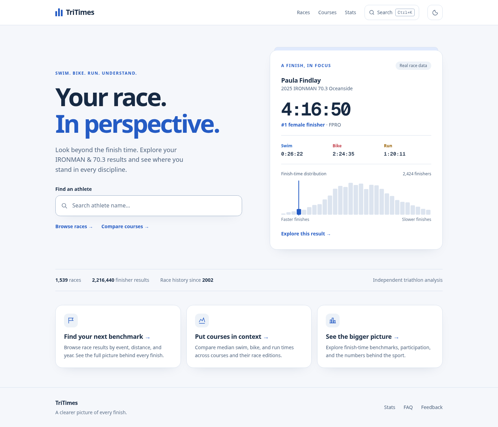
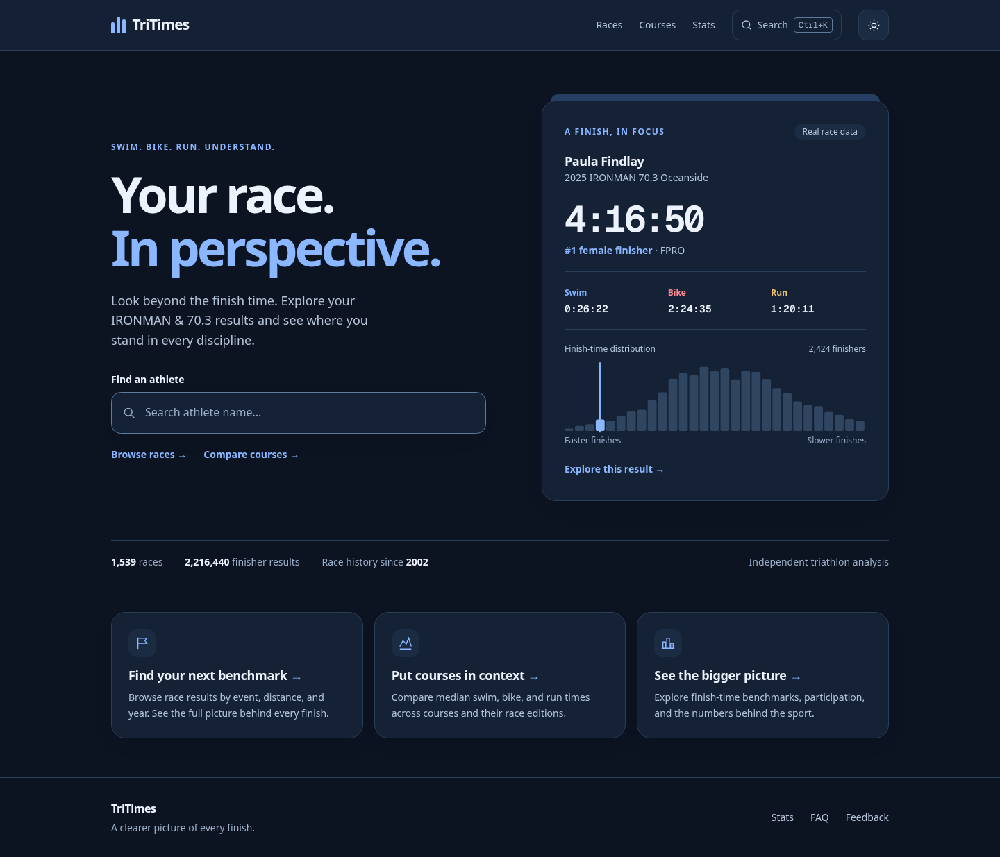
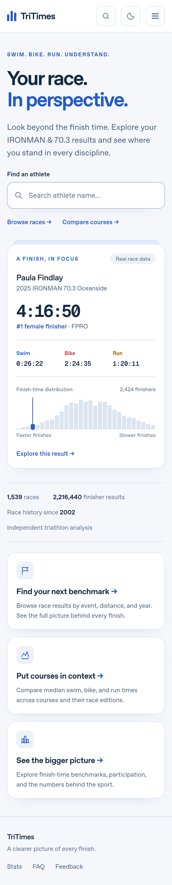
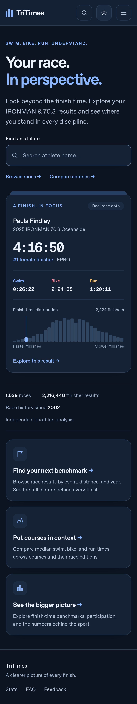
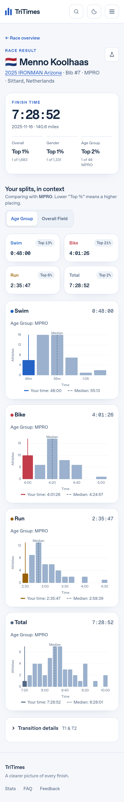
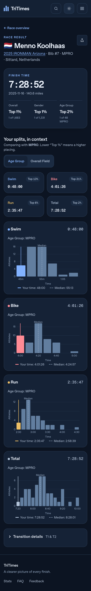

# TriTimes light and dark design review

The approved light direction is the default. A sun/moon button in the shared
header switches to the refined dark direction, remembers the choice across
navigation/reloads, and synchronizes other open tabs. The preference is restored
before first paint. Both themes also work when persistent storage is unavailable.

## What changed

- A search-first homepage with a real, linked race-result example and dataset
  coverage, clearer navigation, a compact brand mark, and consistent page spacing.
- A prominent result summary, readable placement cards, comparison controls
  above the splits, and expandable transitions that reduce the initial density.
- Larger chart labels, responsive SVGs, explicit athlete/median legends, distinct
  discipline colors, and keyboard-accessible course links.
- Shared light/dark surface, text, border, and chart colors across results,
  athlete histories, race browsing, courses, statistics, articles, and FAQ.
- Visible keyboard focus, a skip link, accessible search/control labels, reduced
  motion support, and layouts checked down to 320 px and at 200% text sizing.

Search, filtering, comparisons, chart interactions, and PNG downloads retain
their existing behavior. Share images deliberately retain their existing dark
branding. Data calculations and public route formats are unchanged.

## Actual rendered screenshots

These are unmodified Playwright screenshots of the production build served by
Wrangler, using the committed race data. They are not design mockups. The
homepage and result screenshots below are full-page captures.

| Default light, desktop Chromium | Dark, desktop Chromium |
| --- | --- |
|  |  |

| Light, iPhone emulation / WebKit | Dark, iPhone emulation / WebKit |
| --- | --- |
|  |  |
|  |  |

All browser projects have committed homepage and result screenshots in both
themes. Additional mobile WebKit athlete and course captures are included.

| Browser project | Version recorded | CSS viewport | Homepage | Result |
| --- | --- | --- | --- | --- |
| Desktop Chromium | 156.0.8078.4 | 1440 × 1000 | [Light](design-evidence/desktop-chromium--home--light.png) / [Dark](design-evidence/desktop-chromium--home--dark.png) | [Light](design-evidence/desktop-chromium--result--light.png) / [Dark](design-evidence/desktop-chromium--result--dark.png) |
| Desktop Firefox | 157.0 | 1440 × 1000 | [Light](design-evidence/desktop-firefox--home--light.png) / [Dark](design-evidence/desktop-firefox--home--dark.png) | [Light](design-evidence/desktop-firefox--result--light.png) / [Dark](design-evidence/desktop-firefox--result--dark.png) |
| Desktop WebKit | 27.2 | 1440 × 1000 | [Light](design-evidence/desktop-webkit--home--light.png) / [Dark](design-evidence/desktop-webkit--home--dark.png) | [Light](design-evidence/desktop-webkit--result--light.png) / [Dark](design-evidence/desktop-webkit--result--dark.png) |
| Pixel 7 emulation, Chromium | 156.0.8078.4 | 412 × 839 | [Light](design-evidence/mobile-chromium--home--light.png) / [Dark](design-evidence/mobile-chromium--home--dark.png) | [Light](design-evidence/mobile-chromium--result--light.png) / [Dark](design-evidence/mobile-chromium--result--dark.png) |
| iPhone 13 emulation, WebKit | 27.2 | 390 × 664 | [Light](design-evidence/mobile-webkit--home--light.png) / [Dark](design-evidence/mobile-webkit--home--dark.png) | [Light](design-evidence/mobile-webkit--result--light.png) / [Dark](design-evidence/mobile-webkit--result--dark.png) |

## Verification and provenance

The design suite exercises 135 cases across the five browser projects. Its 100
rendering cases cover ten page types × two themes × five projects: homepage,
result, athlete, filtered race archive, race, courses, course, statistics, average
time article, and FAQ. Each checks HTTP success, loaded content, theme colors,
document overflow, uncaught browser errors, and axe WCAG 2 A/AA and 2.1 AA rules.
The remaining cases cover saved themes, keyboard activation, cross-tab changes,
blocked/invalid storage, no-JavaScript navigation, comparison toggles, transition
expansion, PNG dimensions, narrow layouts, text resizing, search, and race filters.

The existing 40 desktop/mobile regression cases and 186 unit tests also pass.
Astro/TypeScript reports zero errors or warnings. The build emits 3,273 HTML
pages; asset checks validate 33,790 internal URLs and Cloudflare file limits.

[The machine-readable evidence report](design-evidence/report.json) records
run timestamps/counts, exact browser versions and viewports, source-file SHA-256
hashes, all 100 screenshot hashes, and automated accessibility outcomes. It
distinguishes violations from checks that axe could not resolve automatically.
Twenty-four original captures are committed here; all 100, individual axe
reports, and the navigable Playwright report are uploaded by CI as the
`cloudflare-evidence-*` artifact (seven-day retention).

### Reproduce

From `site/`, using Node 24:

```sh
npm ci
npm run build
npm test
npm run check
npm run verify:assets
npx playwright install --with-deps chromium firefox webkit
npm run test:design
PLAYWRIGHT_JSON_OUTPUT_FILE=artifacts/design/parity.json npm run e2e -- --reporter=list,json
node scripts/design-evidence.mjs
npx playwright show-report artifacts/design/report
```

Tests start Wrangler automatically. To verify a deployed build, set `BASE_URL`
to its origin before running either browser suite. CI repeats the design and
regression suites, full-corpus data parity, performance budgets, and Lighthouse
before its existing isolated preview deployment step.

### What this evidence establishes

The screenshots establish how the recorded source renders in real Chromium,
Firefox, and WebKit engines at the listed viewports. Automated checks provide
repeatable evidence of working interactions, theme behavior, and tested layout
constraints. Manual inspection of the homepage, results, course, and athlete
captures checks hierarchy, spacing, readable charts, and consistency.

Visual appeal remains a human judgment. Mobile devices are emulated rather than
physical phones, and WebKit is Safari's engine rather than the branded Safari
application. Axe cannot establish complete accessibility; its unresolved checks
include contrast on decorative arrow glyphs and text over layered backgrounds.
Those are recorded for review rather than silently treated as passes. These
committed captures use the local Cloudflare runtime, not the public CDN. They
are not golden-image comparisons or a claim of exhaustive device coverage.
