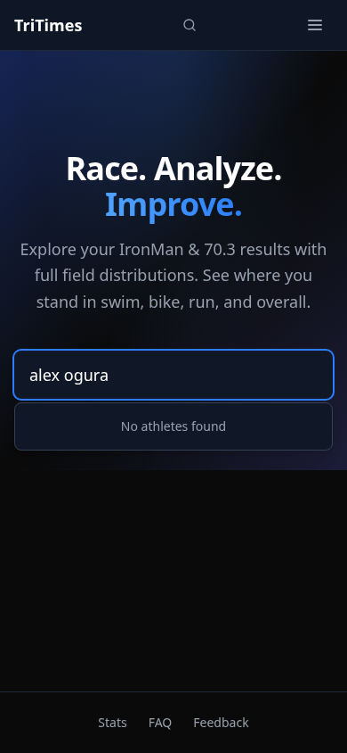
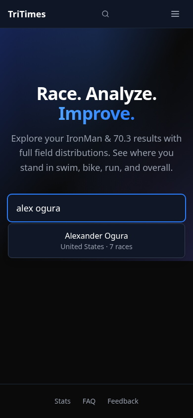
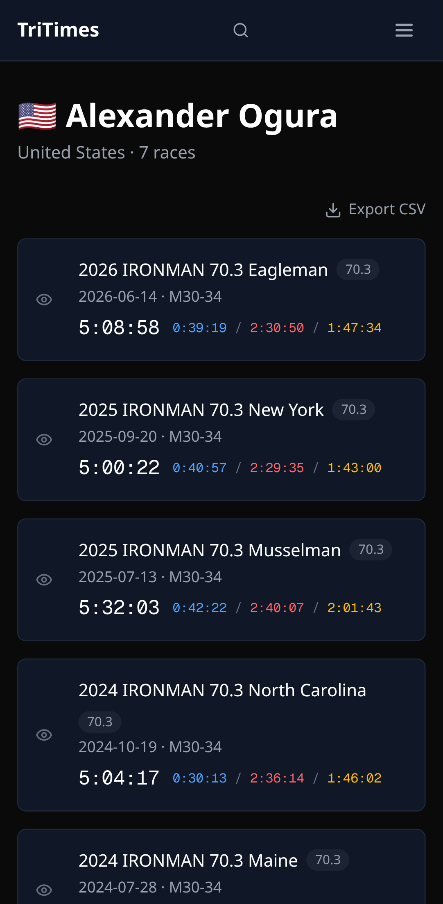
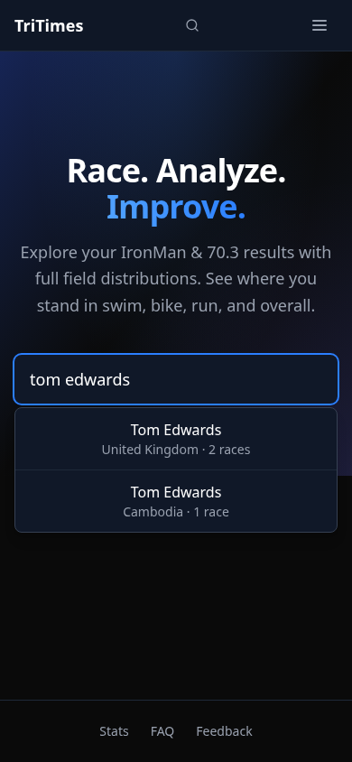
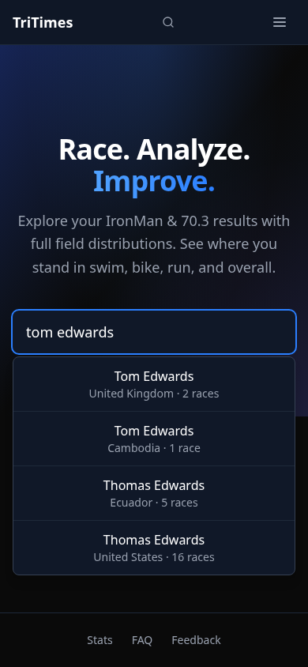
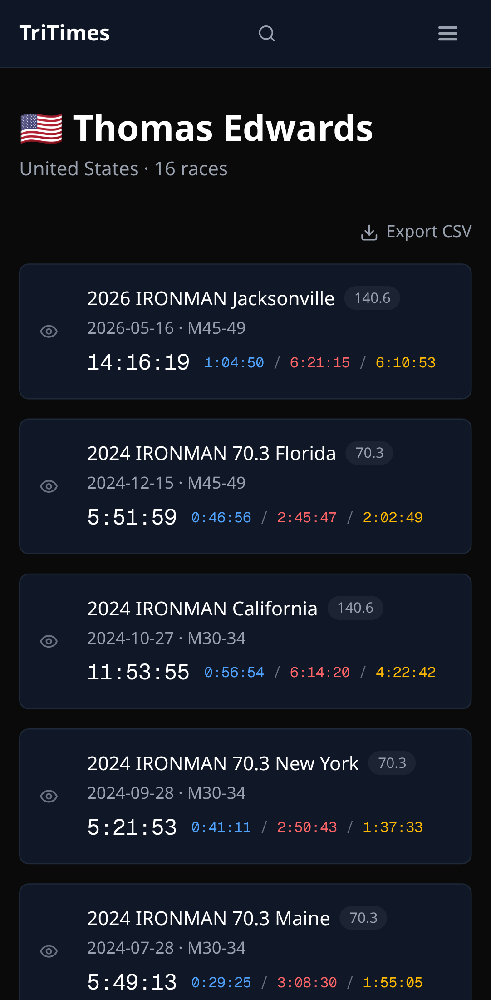

# Athlete nickname search evidence

Verified October 22, 2026 against the production build of this PR and the pre-change
main commit `cfca077b7860a62c2763283611ee026220a21d47`. Both were served by
Cloudflare's local Wrangler runtime. These are local build results, not a claim
that the unmerged change is live on tritimes.org. The complete committed corpus
contains 876,538 athletes; no search responses or athlete profiles were mocked.

## Correctness

The new Playwright tests type the exact requested queries, require a visible link
with the canonical athlete name and exact href, click it, and assert the final
URL, profile heading and page title. All four desktop/mobile cases passed, each
with one search-shard request and no browser JavaScript errors. See [raw navigation evidence](e2e.json).

| Typed query | Required result | Before | After |
| --- | --- | --- | --- |
| `alex ogura` | `/athlete/alexander-ogura--us-m` | Missing | Present; navigation passed |
| `tom edwards` | `/athlete/thomas-edwards--us-m` | Missing (only the UK and Cambodia Tom Edwards records) | Present; navigation passed |

Before/after screenshots are captured by the reproducible browser comparison:

| Query | Before | After | Opened profile |
| --- | --- | --- | --- |
| `alex ogura` |  |  |  |
| `tom edwards` |  |  |  |

## Performance

Five fresh browser contexts per query/version, interleaved before/after; Chromium
150, mobile viewport, 4× CPU slowdown, 150 ms network latency, 200,000 bytes/s
download, browser cache disabled. Timing starts at input fill after hydration and
ends when the dropdown settles. This includes the existing debounce. Local lab
measurements vary and are not production latency guarantees. Raw samples and
request paths are in [browser.json](browser.json).

| Query | Before median | After median | Search gzip bytes, before → after |
| --- | ---: | ---: | ---: |
| `alex ogura` | 4347 ms | 392 ms | 591,073 → 1,154 |
| `tom edwards` | 1038 ms | 391 ms | 66,374 → 2,187 |
| `rootul patel` | 389 ms | 444 ms | 7,290 → 7,290 |
| `thomas edwards` | 1056 ms | 1103 ms | 103,378 → 103,378 |
| `tom` | 1113 ms | 1227 ms | 66,374 → 127,430 |
| `to` | 1973 ms | 2286 ms | 203,771 → 264,825 |

The original `alex ogura` query downloaded both the fine partition and parent
before returning no matches. Both requested queries now load one small partition.
There is a deliberate cost for broad `to`/`tom` queries: their files include the
additional Thomas athletes (about 61 KB more), with approximately 0.31 s / 0.11 s
higher medians in this run. The existing debounce still lets normal typing reach
smaller partitions. Exact name and unrelated control queries retain their result
order and transfer sizes. The fallback Next.js app retains its two-letter shard
strategy, so its `to` file also grows by about 61 KB.

[benchmark.json](benchmark.json) records the full-corpus CPU comparison (1,000
lookup samples and nine key-build samples per query/version), including identical
result ordering for the nine non-alias control queries. Search still uses the
existing binary-search algorithm; aliases are built into keys once per cached
shard. The alias table contains only Alexander → Alex and Thomas → Tom and applies
to the first name token, not surnames. Literal full-name prefixes rank first.

## Checks

- 199 Cloudflare unit tests passed; 221 Next.js unit tests passed.
- All 44 desktop/mobile Cloudflare browser tests passed, including four new alias journeys.
- New alias unit tests failed on the old implementation (six failures) and pass with the fix.
- Production data generation and Astro build passed; Astro check reports zero errors/warnings; Next.js ESLint passed.
- Asset verification passed: 12,471 files against the 20,000 free-tier limit; 33,790 internal URLs checked.

## Reproduce

From a checkout of this PR, build and serve `site/` on port 8787 with `npm ci`,
`npm run build`, and `npm run preview`. In a separate worktree at the baseline
commit above, run the same installation/build and `npx wrangler dev --port 8788`.
Then run these from this PR's `site/` directory:

```sh
npx playwright install chromium
BASE_URL=http://127.0.0.1:8787 npm run e2e -- name-aliases.spec.ts --reporter=list,html --trace=on
BEFORE_URL=http://127.0.0.1:8788 AFTER_URL=http://127.0.0.1:8787 node --import tsx scripts/verify-name-aliases.ts
node --max-old-space-size=4096 --import tsx scripts/benchmark-name-aliases.ts cfca077b7860a62c2763283611ee026220a21d47
```

Set `CHROMIUM_PATH` when using system Chromium. Browser and CPU comparison outputs
are written to `site/artifacts/name-aliases/`; Playwright attaches screenshots,
exact URLs/request paths and traces to its HTML report. The existing PR workflow
runs the four new browser cases and uploads their evidence with the other tests.
